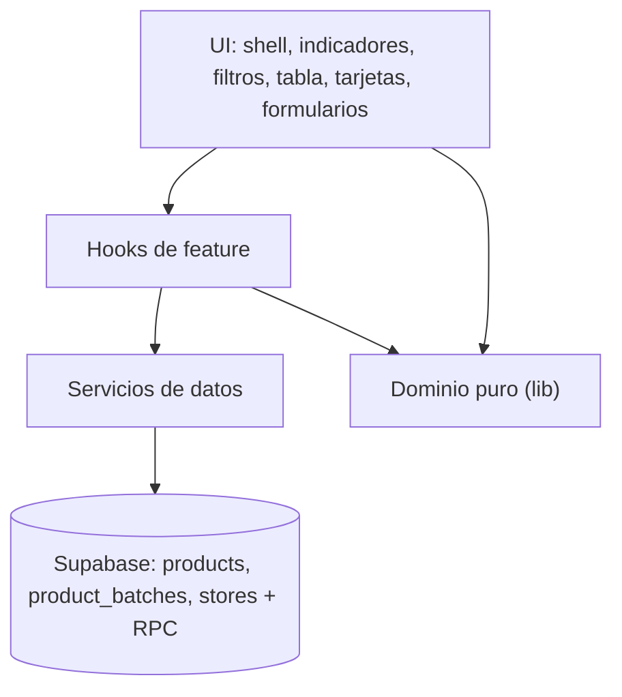

# CONTEXT.md — Control de Vencimientos

> Documento vivo de arquitectura y decisiones estructurales. Se actualiza cuando cambian el stack, los módulos, las integraciones o una decisión de arquitectura; no por ajustes pequeños.

## Propósito

Aplicación web para que el personal de una tienda registre lotes de productos con su fecha de vencimiento y detecte a tiempo qué está por vencer, qué vence hoy y qué ya venció. Resuelve la pérdida de mercadería por vencimientos detectados tarde y elimina el control manual en papel o Excel.

## Alcance y usuarios

- **Usuarios principales:** trabajadores de tienda (registro y consulta) y un administrador que gestiona el acceso.
- **Problema / necesidad:** saber con días de anticipación qué retirar, sin cálculos manuales ni planillas desactualizadas.
- **Funcionalidades incluidas:** alta individual y grupal, catálogo con autocompletado, indicadores, tabla y tarjetas, búsqueda y filtros, edición y borrado, exportación CSV/XLSX, persistencia remota con sesión.
- **Fuera de alcance:** inventario, ventas, compras, notificaciones, multi-tienda operativa, roles, auditoría, analítica.

## Stack

| Elemento | Decisión | Versión |
|---|---|---|
| Framework | React (SPA, sin SSR) | 19.3 |
| Lenguaje | TypeScript estricto | 6.0 |
| Build | Vite | 8.3 |
| Estilos/UI | Tailwind CSS 4 vía `@tailwindcss/vite` (tokens CSS-first) | 4.3 |
| Routing | **Sin router**: una pantalla, login por estado de sesión | — |
| Formularios/validación | Estado controlado de React + validadores puros en `src/lib/validation.ts` | — |
| Iconos | `lucide-react` | 1.x |
| Backend/API | **Sin API propia**: Supabase (PostgREST + RPC) | — |
| Base de datos | PostgreSQL (Supabase) con RLS | 15+ |
| Auth | Supabase Auth, correo + contraseña, registro público desactivado | — |
| Hosting/deploy | Vercel (estático) | — |
| Testing | Vitest + Testing Library + jsdom | 5.x |
| Analítica | N/A (no aprobada) | — |

## Arquitectura

Flujo: `App` (sesión) → componentes de `features/*` → hooks de feature → servicios de datos (`supabase`) → Postgres.
El dominio puro (`src/lib`) no conoce React ni la red: `expiry`, `filters`, `sorting`, `grouping`, `export`, `validation`.



Decisiones estructurales:

1. **Una sola fuente de verdad para vencimientos.** `src/lib/expiry.ts` calcula días y estado; tabla, tarjetas, indicadores, filtros y exportación lo consumen. No se persiste `days_remaining`.
2. **Filtrado en cliente.** Se cargan todos los registros de la tienda (guarda de 5 000) y el catálogo; así indicadores globales y resultados filtrados comparten dataset y la coherencia entre vistas es trivial.
3. **Escritura transaccional única.** El alta individual y la grupal usan la misma RPC `register_batches(p_responsible, p_rows)` con `security invoker`: o se guardan todas las filas o ninguna.
4. **Catálogo normalizado en la base.** `products.normalized_name` lo calcula un trigger con `translate()` (sin extensión `unaccent`): minúsculas, sin acentos latinos, espacios colapsados. `name` conserva el rótulo original.
5. **Preparado para multi-tienda sin implementarlo.** `stores` tiene una fila sembrada y `product_batches.store_id` usa `default public.current_store_id()`; el frontend no envía `store_id`.

## Estructura de carpetas

```text
src/
  app/          # providers y shell de aplicación
  components/   # ui/ (átomos) y layout/ (header, footer, logo)
  features/     # auth, batches, products, filters, dashboard, export
  lib/          # supabase, env, expiry, filters, sorting, grouping, export, validation, errors
  types/        # database.ts (tablas) y domain.ts (dominio/UI)
  styles/       # tokens y estilos globales
  test/         # setup de pruebas
supabase/migrations/   # esquema versionado
docs/                  # PRD, TRD, UX, FLOW, plan, análisis de Fase 0
```

## Integraciones y variables de entorno

| Variable | Uso | Expuesta al cliente | Obligatoria |
|---|---|---:|---:|
| `VITE_SUPABASE_URL` | URL del proyecto Supabase | Sí (pública) | Sí |
| `VITE_SUPABASE_ANON_KEY` | Clave anon pública; RLS protege los datos | Sí (pública) | Sí |

`.env.example` documenta nombres y placeholders; `.env.local` está ignorado por Git. La `service_role` key nunca se usa en el cliente.

## Decisiones técnicas

| Decisión | Motivo | Fecha / contexto |
|---|---|---|
| React + Vite + TS + Tailwind + Supabase + Vercel | Stack aprobado en el prompt maestro y alineado con proyectos hermanos (`Reserva2`) | 2026-11-13 |
| Sin router | Una sola pantalla; el login se resuelve por estado de sesión | 2026-11-13 |
| Sin React Query | Una consulta + refetch explícito tras mutaciones; sin caché multi-cliente | 2026-11-13 |
| Sin React Hook Form ni Zod | Cuatro campos y filas dinámicas simples; validadores propios con mensajes en español | 2026-11-13 |
| Sin CLI de Supabase | Evita Docker/token; 3 archivos SQL aplicables desde el dashboard | 2026-11-13 |
| `write-excel-file` en lugar de `xlsx` | SheetJS en npm está desactualizado y con CVEs de lectura; solo necesitamos escribir | 2026-11-13 |
| Normalización con `translate()` | Determinista, `IMMUTABLE`, sin dependencia de extensión ni de `search_path` | 2026-11-13 |
| `security invoker` en la RPC | Atomicidad sin saltarse RLS | 2026-11-13 |
| Indicadores globales + contador de resultados | Evita ambigüedad entre "general" y "filtrado" (P-13 del análisis) | 2026-11-13 |
| Preferencia de vista en `localStorage` | Solo UI; los datos de negocio siempre viven en Supabase | 2026-11-13 |
| `node-linker=hoisted` en `pnpm-workspace.yaml` | Los enlaces simbólicos del linker aislado no se resuelven en algunos entornos Windows (ESLint: `Cannot find package '@humanfs/node'`; Vite: `Cannot find package 'rolldown'`). El árbol plano funciona igual en CI y Vercel | 2026-11-13 |
| Vitest con `pool: 'threads'` | El pool de procesos lanza hijos con tuberías y falla con `EPERM` en entornos restringidos; los hilos no necesitan procesos externos | 2026-11-13 |
| Paleta neutra + semáforo reservado | Verde, ámbar y rojo solo significan estado de vencimiento; el resto de la UI es tinta/gris/azul. Evita que un rojo decorativo se confunda con «vencido» | 2026-11-13 |
| Una sola familia tipográfica (Inter) | Tabla densa y móvil: pesos y numerales tabulares bastan; evitar dos familias del pairing sugerido para retail | 2026-11-13 |
| `<dialog>` nativo para formularios | Foco atrapado, fondo inerte, Escape y anuncio accesible sin dependencias de UI | 2026-11-13 |
| Store suscribible con `useSyncExternalStore` | La carga de datos no usa `setState` dentro de un efecto (regla `react-hooks/set-state-in-effect`); el estado se comparte entre componentes | 2026-11-13 |
| `batches-service` con interfaz propia | La Fase 4 sustituye la implementación en memoria por Supabase sin tocar componentes ni el hook | 2026-11-13 |
| Logotipo en línea (`components/layout/logo.tsx`) | El `` con SVG no se pintaba en el navegador headless usado para verificar; en línea es nítido, sin petición y reemplazable en un solo archivo | 2026-11-13 |
| Firma tipada a mano para `register_batches` | La inferencia de argumentos de postgrest-js exige coincidencia exacta y resolvía `undefined` con tipos escritos a mano; la firma explícita conserva nombre y argumentos verificados | 2026-11-13 |
| Sin Supabase configurado | Producción muestra pantalla de configuración; desarrollo usa memoria con aviso de modo demostración. Nunca se simula persistencia en producción | 2026-11-13 |

## Requisitos no funcionales

- **Responsive:** móvil, tablet y escritorio; ambas vistas disponibles en todos los tamaños.
- **Accesibilidad:** objetivo WCAG 2.2 AA; estado con texto e icono además de color; foco visible; `aria-live` para confirmaciones.
- **Rendimiento:** bundle inicial < 250 kB gzip; una carga de datos por sesión y refetch tras mutaciones; exportaciones generadas en cliente.
- **Seguridad:** RLS en todas las tablas, sin políticas `anon`, registro público desactivado, CSP y cabeceras en `vercel.json`.
- **SEO:** N/A; `noindex, nofollow` explícito.
- **Observabilidad:** logs de Supabase y de Vercel; errores del cliente traducidos a mensajes accionables sin filtrar detalles técnicos.
