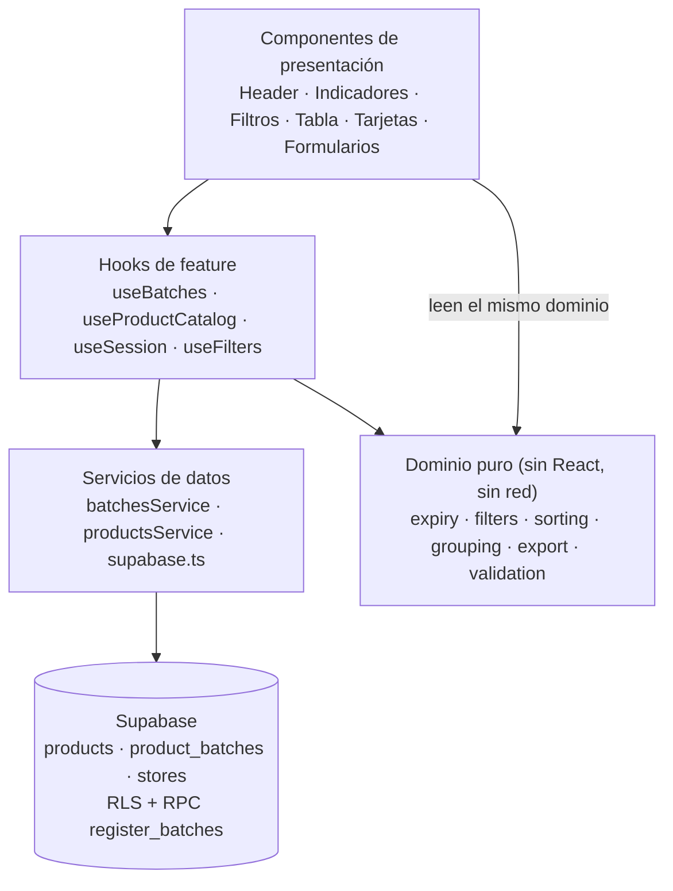
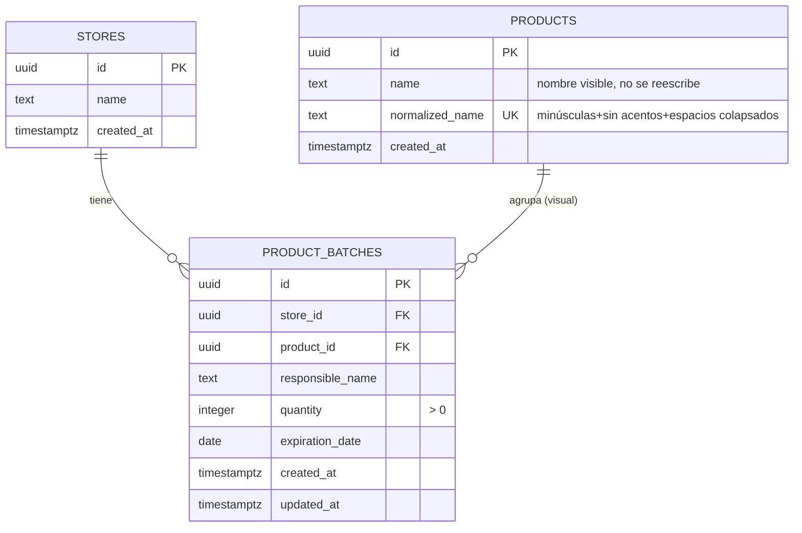

# Fase 0 — Análisis documental y propuesta técnica

> Proyecto: **FechasVencimiento** — control de vencimiento de productos de una tienda.
> Fecha: 2026-11-13 · Estado: **informe para aprobación**. No se ha escrito código de la aplicación.
> Este documento se conserva en el repo como registro de la Fase 0.

## 0. Resumen ejecutivo

1. Los 10 archivos `.md` de `E:\Proyectos\Boveda-Obsidian\Proyectos` son la **plantilla maestra**, no documentación de este proyecto: no contienen datos reales ni decisiones del producto. El `README.md` lo dice explícitamente ("esta carpeta contiene la plantilla, no un proyecto concreto").
2. Por tanto, la Fase 0 no consiste en "descartar" archivos, sino en **copiar la plantilla a `E:\Proyectos\FechasVencimiento`, rellenar los documentos con el proyecto real y añadir los docs de ingeniería (`docs/`)** que la propia plantilla exige para proyectos con backend.
3. La plantilla tiene **tres tensiones reales** con este proyecto: asume sitio público indexable (SEO/legal), asume API propia (contrato, health check, rate limiting) y prohíbe commit/push sin pedido explícito (el pedido de documentar en GitHub por ramas lo autoriza).
4. La arquitectura propuesta es **React 19 + TypeScript + Vite 8 + Tailwind 4 + Supabase (Postgres + RLS + Auth) + Vercel**, alineada con tus proyectos hermanos (`Reserva2` es el más parecido), **sin router, sin react-query, sin librería de formularios y sin CLI de Supabase** para Fase 1: la app es una sola pantalla, el catálogo de productos es pequeño y la base se crea con dos archivos SQL versionados. Cada exclusión está justificada y es reversible.
5. La lógica de vencimientos queda **centralizada** en un módulo puro (`lib/expiry.ts`) con pruebas sobre los 7 casos del prompt; el cálculo no se persiste; la agrupación de tarjetas es solo visual.
6. Quedan **4 bloqueos** antes de la Fase 1: permiso de escritura en `E:\Proyectos\FechasVencimiento` (el sandbox de esta sesión solo permite escribir en `D:\WorkSpaces Deepseek\WorkSpace FechasVencimiento`), proyecto Supabase y credenciales, repo de GitHub, y aprobación de la lista de dependencias.

---

## 1. Inventario de archivos encontrados

Búsqueda en `E:\Proyectos\Boveda-Obsidian\Proyectos` (carpeta de la bóveda Obsidian; nivel superior: solo `.obsidian/` y `Proyectos/`).

| # | Archivo | Bytes | Líneas | Contenido real | Placeholders |
|---|---|---:|---:|---|---|
| 1 | `AGENTS.md` | 6 146 | 77 | Rol, autonomía, confirmaciones, flujo, comandos, reglas técnicas, Git, entrega | 0 |
| 2 | `PROJECT_BRIEF.md` | 1 392 | 55 | Esqueleto de brief | Todo vacío |
| 3 | `CONTEXT.md` | 2 478 | 63 | Esqueleto de arquitectura | Todo vacío |
| 4 | `MEMORY.md` | 958 | 26 | Esqueleto de memoria estable | Vacío |
| 5 | `SKILLS.md` | 4 129 | 64 | 7 procedimientos repetibles | 0 |
| 6 | `QUALITY_CHECKLIST.md` | 3 503 | 64 | Checklist de entrega | 0 (todo sin marcar) |
| 7 | `SECURITY_CHECKLIST.md` | 2 268 | 38 | Checklist de seguridad | 0 |
| 8 | `SEO_LAUNCH_CHECKLIST.md` | 1 939 | 32 | Checklist SEO y legal | 0 |
| 9 | `BACKEND_CHECKLIST.md` | 3 155 | 49 | Checklist de API/BD/operación | 0 |
| 10 | `README.md` | 10 656 | 117 | Manual de la plantilla | 0 |

Notas del inventario:

- **`AGENTS.md` existe pero no lo referenciaste**: es el archivo **canónico** que los agentes leen en la raíz del repo. Es el más importante de los 10.
- No hay `brief.md`, `architecture.md`, `design-system.md`, `tech-stack.md`, `conventions.md` ni `tasks.md` (los nombres del enunciado eran hipotéticos); su contenido está cubierto por `PROJECT_BRIEF`, `CONTEXT`, `SKILLS` y `IMPLEMENTATION_PLAN` (pendiente de crear).
- No hay documentación previa de este producto. `E:\Proyectos\FechasVencimiento` está vacío y sin repositorio Git.
- Entorno verificado: Node `v22.19.0`, npm `10.9.3`, pnpm `11.0.9`, Git `2.51.0`, credenciales de GitHub funcionando (`RenzoTM2705`), red disponible. **No hay** `gh` CLI ni `supabase` CLI instalados.

---

## 2. Clasificación y justificación

| Archivo | Categoría | Justificación | Acción propuesta |
|---|---|---|---|
| `AGENTS.md` | **Indispensable** | Único archivo con reglas operativas vinculantes (autonomía, confirmaciones, flujo, Git). Sin él, el agente no tiene contrato de trabajo. | Copiar a la raíz. Ajustar solo la sección *Comandos* a los scripts reales cuando existan. |
| `PROJECT_BRIEF.md` | **Indispensable** | Define alcance, usuarios, requisitos y fuera de alcance. Sin brief rellenado se improvisan requisitos. | Copiar y rellenar con este proyecto; marcar `N/A` en marca/CTA/contacto. |
| `CONTEXT.md` | **Indispensable** | Documento vivo de stack, arquitectura, carpetas, variables de entorno y decisiones. | Copiar y rellenar **antes** de la Fase 1 (es la fuente de verdad técnica). |
| `SECURITY_CHECKLIST.md` | **Indispensable** | La app maneja datos de tienda con Supabase expuesto al cliente: RLS, secretos y sesiones son riesgo real. | Copiar tal cual; se completa en Fase 4 y en la entrega. |
| `BACKEND_CHECKLIST.md` | **Útil** (parcial) | Hay backend (Supabase), pero no API propia: ~40 % de los ítems no aplican. | Copiar y marcar `N/A` con motivo; conservar los de BD, RLS, migraciones y testing. |
| `QUALITY_CHECKLIST.md` | **Útil** | Checklist de entrega aplicable casi por completo; su bloque *Seguridad* duplica `SECURITY_CHECKLIST`. | Copiar; usar en Fase 8. Mantener la duplicación como doble verificación (coste cero). |
| `SKILLS.md` | **Útil** | Procedimientos aplicables (formulario, revisión, migración, decisión). Su paso de "metadatos por ruta" no aplica (una sola ruta). | Copiar; ejecutar solo los pasos aplicables y registrar los omitidos. |
| `SEO_LAUNCH_CHECKLIST.md` | **Redundante / mayormente N/A** | La app es privada con login: no se indexa. Solo aplican `title`, `description`, favicon y, si algún día hay analítica, el bloque legal. | Copiar y marcar `N/A` con motivo; **no** crear sitemap, robots indexable, OG social ni datos estructurados. |
| `MEMORY.md` | **Útil** | Útil para decisiones cerradas y restricciones; riesgo de convertirlo en changelog (lo advierte el propio archivo). | Copiar; llenar con decisiones aprobadas; los hitos van a `docs/IMPLEMENTATION_PLAN.md`. |
| `README.md` | **Prescindible en el proyecto** | Es el manual de **la plantilla maestra** y se autodescribe como "no hace falta copiarlo a cada proyecto". | **No copiar**. El proyecto tendrá su propio `README.md` (qué es, stack, setup, env, ramas, deploy). |

Conclusión: **ningún archivo se descarta por estar obsoleto**; 4 son indispensables, 4 útiles, 1 mayormente N/A y 1 no debe copiarse. La plantilla maestra **no se modifica** (es la biblioteca compartida para todos tus proyectos).

---

## 3. Problemas y contradicciones detectadas

| ID | Problema | Impacto | Resolución propuesta |
|---|---|---|---|
| P-01 | Los 4 documentos centrales (`PROJECT_BRIEF`, `CONTEXT`, `MEMORY`, `SKILLS`) están vacíos: son plantilla, no proyecto. | Un agente "rellena" con suposiciones o se bloquea. | Rellenarlos en la Fase 1 con datos aprobados; nada de `[definir]` en la entrega. |
| P-02 | El usuario pidió "documentar en GitHub por ramas", pero `AGENTS.md` (Git) prohíbe commit/push sin pedido explícito. | Ambigüedad de permisos. | El pedido es la autorización explícita: commits y push a ramas del repo de este proyecto. **Deploy a Vercel sigue requiriendo aprobación** (no se pidió desplegar). |
| P-03 | `AGENTS.md` exige confirmación antes de añadir dependencias y antes de introducir autenticación. | Fricción con el stack ya definido. | El stack y Supabase Auth se registran como **decisión aprobada** en `CONTEXT.md`/`MEMORY.md`; la lista exacta de paquetes se aprueba una vez (sección 6) y no se añade nada fuera de ella sin preguntar. |
| P-04 | `CONTEXT.md` propone `VITE_PUBLIC_API_URL` y estructura `src/app|pages|features|services|hooks|utils`. | No corresponde a este stack (Supabase, una sola ruta). | Adaptar la tabla de variables (`VITE_SUPABASE_URL`, `VITE_SUPABASE_ANON_KEY`) y la estructura (sección 5.3), documentando la desviación en *Decisiones técnicas*. |
| P-05 | `QUALITY_CHECKLIST` y `SEO_LAUNCH_CHECKLIST` asumen sitio público: sitemap, canonical, OG, Search Console, política de cookies. | Trabajo inútil y riesgo de "cumplir" con artefactos falsos. | App privada: `noindex` explícito, sin sitemap/OG/datos estructurados. Legal solo si se añade analítica (no está en alcance). |
| P-06 | `BACKEND_CHECKLIST` asume API propia: contrato OpenAPI, `/health`, versionado, rate limiting. | Ítems imposibles de cumplir y reportes de entrega engañosos. | Marcar `N/A` con motivo ("BaaS Supabase: sin API propia"); conservar RLS, constraints, índices, migraciones, testing y `.env.example`. |
| P-07 | `BACKEND_CHECKLIST` exige paginación en listados; el prompt exige ver todos los registros y filtrar en cliente. | Consultas potencialmente grandes. | Fase 1: una sola carga (registros + catálogo) con `limit` de seguridad (5 000) y filtrado/orden en cliente. Documentar como trade-off; paginación solo si el volumen lo exige. |
| P-08 | `SECURITY_CHECKLIST` exige "validación y autorización en servidor". | Con Supabase no hay servidor propio. | Equivalencia explícita: autorización = **RLS** en Postgres (servidor); validación = constraints + RPC `security invoker`; la validación del cliente es solo UX. |
| P-09 | `SKILLS.md` paso "añadir metadatos por ruta". | No hay rutas. | `N/A`: un solo `index.html` con `title`, `description`, favicon y `noindex`. |
| P-10 | `MEMORY.md` prohíbe ser changelog; el plan por fases invita a registrar hitos. | Memoria contaminada. | Hitos y estado de fases en `docs/IMPLEMENTATION_PLAN.md`; `MEMORY.md` solo decisiones cerradas y restricciones. |
| P-11 | `PROJECT_BRIEF` pide marca, CTA, contacto, SEO y conversión. | No aplica a una herramienta interna. | `N/A` con motivo; el logotipo queda como **espacio reservado** (`public/logo.svg` reemplazable) sin inventar marca. |
| P-12 | Regla "no inventar datos" vs. datos que el prompt deja abiertos (nombre comercial, umbral de cantidades bajas, definición exacta de indicadores). | Riesgo de suposición silenciosa. | Sección 13: decisiones por defecto explícitas + 4 bloqueos que requieren tu respuesta. |
| P-13 | El prompt mezcla "indicadores generales" con "indicadores filtrados" ("si se decide..."). | Indicadores incoherentes entre vistas. | Indicadores **globales** (sobre todos los registros) + contador separado "N resultados". Documentado en PRD. |
| P-14 | Umbral de "cantidades bajas" sin definir. | Funcionalidad a medio hacer. | Fuera de alcance v1; preparado como filtro futuro, sin UI ni configuración. |

---

## 4. Propuesta de estructura documental definitiva

```text
E:\Proyectos\FechasVencimiento\
├─ AGENTS.md                  ← plantilla, comandos ajustados a los scripts reales
├─ README.md                  ← NUEVO (del proyecto): qué es, stack, setup, env, ramas, deploy
├─ PROJECT_BRIEF.md           ← plantilla rellenada (N/A donde no aplique)
├─ CONTEXT.md                 ← plantilla rellenada: stack, capas, env, decisiones
├─ MEMORY.md                  ← decisiones cerradas, restricciones, estado
├─ SKILLS.md                  ← plantilla tal cual
├─ QUALITY_CHECKLIST.md       ← plantilla tal cual (se marca en Fase 8)
├─ SECURITY_CHECKLIST.md      ← plantilla tal cual (se marca en Fase 4 y 8)
├─ SEO_LAUNCH_CHECKLIST.md    ← plantilla, 80 % N/A con motivo
├─ BACKEND_CHECKLIST.md       ← plantilla, ítems sin API marcados N/A
├─ docs/
│  ├─ 00-fase-0-analisis.md   ← este informe
│  ├─ PRD.md                  ← requisitos, umbrales, criterios de aceptación, indicadores
│  ├─ TRD.md                  ← modelo de datos, RLS, RPC, env, operación, despliegue
│  ├─ UX.md                   ← sistema de diseño, tokens, estados, reglas responsive
│  ├─ FLOW.md                 ← flujos con Mermaid (alta individual, alta grupal, edición, export)
│  └─ IMPLEMENTATION_PLAN.md  ← fases, ramas, riesgos, rollback, estado
├─ supabase/migrations/*.sql  ← esquema versionado (aplicable con SQL Editor)
├─ .github/workflows/ci.yml   ← lint + typecheck + test + build
├─ .env.example
├─ vercel.json                ← headers de seguridad (CSP) y cache de assets
└─ src/ …
```

Reglas de la propuesta:

- **No se duplica** el contenido de `PRD` en `PROJECT_BRIEF`: el brief apunta al PRD para el detalle funcional.
- **No se crea `DECISIONS.md`** (ADR): `CONTEXT.md` § *Decisiones técnicas* + `MEMORY.md` cubren el caso; solo se crearían ADR si una decisión requiere contexto largo.
- Los enlaces entre documentos son **relativos y normales** (`[TRD](docs/TRD.md)`), nunca wikilinks (regla del README maestro §4).
- La bóveda Obsidian solo enlaza a estos archivos; no los copia (evita *drift*).
- Los checklists se copian **sin editar**; el estado se marca con fecha y quién verificó al cierre de cada fase.

---

## 5. Arquitectura técnica recomendada

### 5.1 Stack

| Capa | Elección | Versión objetivo | Motivo |
|---|---|---|---|
| Framework | React | 19.3 | Igual que `Reserva2`, `Portafolio`, `lanza-la-moneda` |
| Lenguaje | TypeScript | ~6.0 | `strict: true`; tipos del dominio a mano (esquema pequeño) |
| Build | Vite | 8.3 | Igual que proyectos hermanos; Node 22.19 compatible |
| Estilos | Tailwind CSS | 4.3 (`@tailwindcss/vite`) | Tokens CSS-first; sin `tailwind.config.js` |
| Iconos | `lucide-react` | 1.x | Tree-shakeable, coherente con `Reserva2` |
| Backend/BD | Supabase (Postgres 15+) | — | Persistencia remota, Auth, RLS; sin servidor propio |
| Cliente BD | `@supabase/supabase-js` | 2.119 | Cliente oficial; solo `anon key` en el navegador |
| Deploy | Vercel | — | Hosting estático + variables de entorno |
| Tests | Vitest + Testing Library + jsdom | 5.x | Pruebas de lógica pura y de interacción |
| Lint | ESLint 10 + `typescript-eslint` 8 | — | Igual que proyectos hermanos |

**No se usa** (y por qué): React Router (una sola pantalla; login gate por estado de sesión), TanStack Query (una consulta + refetch explícito, sin caché multi-cliente), React Hook Form + Zod (4 campos y filas dinámicas: estado controlado + validador puro propio; Zod duplicaría los mensajes en español), Supabase CLI (requiere Docker/token; el esquema son 2 archivos SQL aplicables desde el dashboard), SheetJS (`xlsx` en npm está desactualizado y con CVEs de lectura; solo necesitamos escribir), `pg_trgm` (el autocompletado se resuelve en cliente sobre el catálogo cargado).

### 5.2 Capas y flujo de datos



Regla de oro: **la UI nunca calcula días restantes ni estados por su cuenta**; todo pasa por `lib/expiry.ts`, de modo que tabla, tarjetas, indicadores, filtros y exportación no pueden divergir.

### 5.3 Estructura de carpetas

```text
src/
├─ main.tsx
├─ App.tsx                      # sesión → LoginPage o AppShell
├─ app/
│  ├─ providers.tsx             # sesión de Supabase, toasts
│  └─ app-shell.tsx             # Header + main + Footer
├─ components/
│  ├─ ui/                       # Button, Input, Select, Badge, Dialog, Field, EmptyState, Skeleton
│  └─ layout/                   # header.tsx, footer.tsx, logo-slot.tsx
├─ features/
│  ├─ auth/                     # login-page.tsx, use-session.ts
│  ├─ batches/                  # use-batches.ts, batches-service.ts, batch-table.tsx,
│  │                            # batch-cards.tsx, batch-form-dialog.tsx, bulk-form-dialog.tsx,
│  │                            # delete-confirm-dialog.tsx, expiry-badge.tsx
│  ├─ products/                 # product-combobox.tsx, use-product-catalog.ts, products-service.ts
│  ├─ filters/                  # filter-bar.tsx, use-filters.ts
│  ├─ dashboard/                # indicator-cards.tsx
│  └─ export/                   # export-menu.tsx
├─ lib/                         # supabase.ts, env.ts, expiry.ts, filters.ts, sorting.ts,
│                               # grouping.ts, export-csv.ts, export-xlsx.ts, validation.ts,
│                               # errors.ts, download.ts, cn.ts, format.ts
├─ types/                       # database.ts (tablas), domain.ts (vistas/UI)
├─ styles/                      # index.css (tokens @theme)
└─ test/                        # setup.ts, factories.ts
```

### 5.4 Decisiones de arquitectura (y desviaciones de la plantilla)

| Decisión | Motivo |
|---|---|
| Una sola ruta sin router | Login → app es un condicional por sesión; añadir router sería dependencia sin uso. Se documenta como desviación de `CONTEXT.md` (plantilla). |
| Cálculo de vencimientos en cliente, no en SQL | Una única fuente de verdad (TS). La BD guarda `date`, nunca `days_remaining` (el prompt lo prohíbe). |
| Consulta única + filtrado en cliente | Indicadores globales y resultados filtrados comparten dataset; coherente entre tabla y tarjetas; una tienda. |
| RPC `register_batches` con `security invoker` | Atomicidad del alta grupal (requisito del prompt) sin `security definer` ni saltarse RLS. |
| Normalización con `translate()` en Postgres | Sin extensión `unaccent` (evita problemas de esquema/`search_path` y de inmutabilidad en índices). Cubre acentos latinos, `ñ` y `ç`. |
| `store_id` con `default current_store_id()` | Preparado para multi-tienda sin UI ni selector; el frontend no envía `store_id`. |
| Sin `localStorage` para datos; solo preferencia de vista/filtros | El prompt prohíbe almacenamiento local como fuente; la preferencia de UI no son datos de negocio. |

---

## 6. Dependencias propuestas (requieren aprobación)

| Paquete | Tipo | Por qué | Alternativa descartada |
|---|---|---|---|
| `react`, `react-dom` | prod | Base | — |
| `@supabase/supabase-js` | prod | Cliente Supabase | REST a mano (reinventa auth y errores) |
| `lucide-react` | prod | Iconos accesibles | SVG a mano (mantenimiento) |
| `write-excel-file` | prod | Generar `.xlsx` en el navegador, sin CVEs conocidas | `xlsx`/SheetJS npm (0.18.5 con CVEs), `exceljs` (pesado) |
| `@fontsource-variable/inter` | prod | Tipografía legible y numérica tabular | Fuente del sistema (menos control de legibilidad) |
| `vite`, `@vitejs/plugin-react`, `typescript` | dev | Build y tipos | — |
| `tailwindcss`, `@tailwindcss/vite` | dev | Estilos y tokens | CSS Modules (más código para un sistema de estados) |
| `vitest`, `jsdom`, `@testing-library/react`, `@testing-library/jest-dom` | dev | Pruebas de dominio y UI | Pruebas manuales (sin red de seguridad en umbrales) |
| `eslint`, `@eslint/js`, `typescript-eslint`, `eslint-plugin-react-hooks`, `eslint-plugin-react-refresh`, `globals` | dev | Calidad estática | — |
| `@types/react`, `@types/react-dom`, `@types/node` | dev | Tipos | — |

Total: **5 dependencias de producción**, el resto de desarrollo. Sin cambios de stack respecto a lo pedido.

---

## 7. Modelo de datos preliminar

### 7.1 Diagrama



### 7.2 DDL propuesto (`supabase/migrations/`)

```sql
-- 0001_core.sql -------------------------------------------------------------
create table if not exists public.stores (
  id uuid primary key default gen_random_uuid(),
  name text not null check (char_length(btrim(name)) between 1 and 80),
  created_at timestamptz not null default now()
);

insert into public.stores (id, name)
values ('00000000-0000-0000-0000-000000000001', 'Tienda principal')
on conflict (id) do nothing;

create or replace function public.current_store_id()
returns uuid language sql stable set search_path = public as $$
  select id from public.stores order by created_at, id limit 1;
$$;

create table if not exists public.products (
  id uuid primary key default gen_random_uuid(),
  name text not null check (char_length(btrim(name)) between 1 and 120),
  normalized_name text not null,
  created_at timestamptz not null default now(),
  constraint products_normalized_name_key unique (normalized_name)
);

create or replace function public.normalize_product_name(p_name text)
returns text language sql immutable as $$
  select btrim(regexp_replace(
    translate(lower(coalesce(p_name, '')),
      'áàäâãéèëêíìïîóòöôõúùüûñç',
      'aaaaaeeeeiiiiooooouuuunc'),
    '\s+', ' ', 'g'));
$$;

create or replace function public.products_set_normalized_name()
returns trigger language plpgsql as $$
begin
  new.normalized_name := public.normalize_product_name(new.name);
  if new.normalized_name = '' then
    raise exception 'PRODUCT_NAME_REQUIRED' using errcode = 'P0001';
  end if;
  return new;
end $$;

create trigger products_normalize_name
before insert or update of name on public.products
for each row execute function public.products_set_normalized_name();

create table if not exists public.product_batches (
  id uuid primary key default gen_random_uuid(),
  store_id uuid not null default public.current_store_id()
    references public.stores(id) on delete restrict,
  product_id uuid not null references public.products(id) on delete restrict,
  responsible_name text not null
    check (char_length(btrim(responsible_name)) between 1 and 80),
  quantity integer not null check (quantity > 0),
  expiration_date date not null,
  created_at timestamptz not null default now(),
  updated_at timestamptz not null default now()
);

create index if not exists product_batches_store_expiration_idx
  on public.product_batches (store_id, expiration_date);
create index if not exists product_batches_product_idx
  on public.product_batches (product_id);
create index if not exists product_batches_responsible_idx
  on public.product_batches (store_id, responsible_name);

create or replace function public.set_updated_at()
returns trigger language plpgsql as $$
begin new.updated_at := now(); return new; end $$;

create trigger product_batches_set_updated_at
before update on public.product_batches
for each row execute function public.set_updated_at();

-- 0002_rls.sql --------------------------------------------------------------
alter table public.stores          enable row level security;
alter table public.products        enable row level security;
alter table public.product_batches enable row level security;

create policy stores_select_authenticated on public.stores
  for select to authenticated using (true);

create policy products_select_authenticated on public.products
  for select to authenticated using (true);
create policy products_insert_authenticated on public.products
  for insert to authenticated with check (true);
create policy products_update_authenticated on public.products
  for update to authenticated using (true) with check (true);

create policy batches_select_authenticated on public.product_batches
  for select to authenticated using (true);
create policy batches_insert_authenticated on public.product_batches
  for insert to authenticated with check (true);
create policy batches_update_authenticated on public.product_batches
  for update to authenticated using (true) with check (true);
create policy batches_delete_authenticated on public.product_batches
  for delete to authenticated using (true);

-- 0003_rpc.sql --------------------------------------------------------------
create or replace function public.register_batches(
  p_responsible text,
  p_rows jsonb
) returns integer
language plpgsql
security invoker
set search_path = public
as $$
declare
  v_store uuid := public.current_store_id();
  v_row record;
  v_norm text;
  v_pid uuid;
  v_count integer := 0;
begin
  if btrim(coalesce(p_responsible, '')) = '' then
    raise exception 'RESPONSIBLE_REQUIRED' using errcode = 'P0001';
  end if;
  if p_rows is null or jsonb_typeof(p_rows) <> 'array'
     or jsonb_array_length(p_rows) = 0 then
    raise exception 'ROWS_REQUIRED' using errcode = 'P0001';
  end if;

  for v_row in
    select * from jsonb_to_recordset(p_rows)
      as x(product_name text, quantity integer, expiration_date date)
  loop
    v_norm := public.normalize_product_name(v_row.product_name);
    if v_norm = '' then
      raise exception 'PRODUCT_REQUIRED' using errcode = 'P0001';
    end if;
    if v_row.quantity is null or v_row.quantity <= 0 then
      raise exception 'INVALID_QUANTITY' using errcode = 'P0001';
    end if;
    if v_row.expiration_date is null then
      raise exception 'INVALID_DATE' using errcode = 'P0001';
    end if;

    v_pid := null;  -- evita reutilizar el id de la fila anterior
    insert into public.products (name) values (btrim(v_row.product_name))
      on conflict (normalized_name) do nothing
      returning id into v_pid;
    if v_pid is null then
      select id into v_pid from public.products where normalized_name = v_norm;
    end if;

    insert into public.product_batches
      (store_id, product_id, responsible_name, quantity, expiration_date)
    values
      (v_store, v_pid, btrim(p_responsible), v_row.quantity, v_row.expiration_date);

    v_count := v_count + 1;
  end loop;

  return v_count;
end $$;

revoke all on function public.register_batches(text, jsonb) from public, anon;
grant execute on function public.register_batches(text, jsonb) to authenticated;
```

Notas de integridad:

- El alta grupal es **una sola transacción**: si una fila falla, el `raise exception` revierte todo (requisito del prompt). El frontend usa el mismo RPC para el alta individual (`p_rows` con 1 elemento): un solo camino de escritura, sin lógica duplicada.
- `products.name` conserva el nombre visible original; la normalización solo alimenta `normalized_name`, así que "Leche Gloria", "leche gloria" y " LECHE GLORIA " son el mismo producto sin reescribir el rótulo.
- `product_batches` **no** tiene unicidad por producto/fecha: el prompt exige registros independientes del mismo producto.
- Códigos de error estables (`RESPONSIBLE_REQUIRED`, `PRODUCT_REQUIRED`, `INVALID_QUANTITY`, `INVALID_DATE`, `ROWS_REQUIRED`) mapeados a mensajes en español en `lib/errors.ts`; el usuario nunca ve el mensaje técnico.
- `updated_at` por trigger; `created_at` por default. Sin `days_remaining` persistido.

### 7.3 Seguridad y acceso

- **Auth**: Supabase Auth (email + contraseña), **registro público deshabilitado** en el dashboard; un único usuario administrador creado a mano. El frontend solo usa `anon key`; la `service_role` nunca aparece en el cliente ni en `.env.example`.
- **RLS** activada en las 3 tablas; sin políticas para `anon` (acceso cero). `product_batches` no permite borrar productos en cascada (`on delete restrict`).
- **Función RPC**: `security invoker` + `revoke` de `execute` a `public` y `anon`.
- Verificación de cierre: `curl` con la `anon key` debe devolver `[]` (o error de permiso) en las 3 tablas y en el RPC.
- `.env.example` solo con nombres y placeholders; `.env.local` ignorado por Git.
- Endurecimiento de hosting: `vercel.json` con CSP (`connect-src https://*.supabase.co`), `X-Content-Type-Options`, `Referrer-Policy`, `frame-ancestors 'none'`.

---

## 8. Lógica de vencimientos

| `days_remaining` | Estado | Etiqueta visible | Color (token) |
|---:|---|---|---|
| `> 21` | `vigente` | Vigente | verde `--color-ok` |
| `11 … 21` | `proximo` | Próximo a vencer | amarillo `--color-warn` |
| `1 … 10` | `critico` | Crítico | rojo `--color-danger` |
| `0` | `vence_hoy` | **Vence hoy** | rojo intenso `--color-danger-strong` |
| `< 0` | `vencido` | **Vencido** (hace N días) | rojo intenso + trama/icono |

- Cálculo: `Date.UTC(año, mes-1, día)` de ambos extremos / 86 400 000, con la fecha local del navegador; nunca resta de `Date.now()` ni `new Date('YYYY-MM-DD')` (que interpreta UTC).
- `expiration_date` es `date` en Postgres (sin zona horaria); el transporte es `string` `YYYY-MM-DD`.
- Aviso **"FECHA CUMPLIDA, RETIRAR INMEDIATAMENTE"** cuando `days_remaining <= 0`, destacado (banner + icono + texto), no dependiente solo del color.
- Distinción `vence_hoy` vs `vencido`: etiqueta textual distinta, icono distinto y "Vencido hace N días"; ambos con el aviso.
- Casos de prueba obligatorios: 22, 21, 11, 10, 1, 0, −1 días.

---

## 9. Plan de desarrollo por etapas

| Fase | Rama | Entregable | Criterio de salida |
|---|---|---|---|
| 0 | `docs/fase-0-analisis` | Este informe + docs base rellenados | Tu aprobación |
| 1 | `feat/fase-1-scaffold` | Vite+TS+Tailwind+ESLint+Vitest, estructura, tipos, `.env.example`, `docs/` inicial, CI | `lint`, `typecheck`, `test`, `build` en verde |
| 2 | `feat/fase-2-interfaz` | Header (slot de logo), footer, indicadores, filtros, tabla y tarjetas responsive con datos simulados | Revisión visual en 360/768/1280 px; ambas vistas |
| 3 | `feat/fase-3-registro` | Alta individual, alta grupal (filas dinámicas), validaciones, autocompletado | Formularios probados sin BD (servicio simulado) |
| 4 | `feat/fase-4-supabase` | Migraciones, RLS, RPC, conexión, CRUD real, sesión | Datos persisten tras recargar; `anon` sin acceso |
| 5 | `feat/fase-5-vencimientos` | `expiry.ts` + pruebas de umbrales, badges, avisos, indicadores | 7 casos de prueba en verde |
| 6 | `feat/fase-6-filtros` | Buscador, filtros combinables, orden, contador, limpiar, coherencia con tarjetas | Matriz de filtros del prompt cumplida |
| 7 | `feat/fase-7-crud-export` | Edición, eliminación con confirmación, exportación CSV/XLSX (todos/filtrados) | Archivos abren en Excel/LibreOffice con datos correctos |
| 8 | `docs/fase-8-qa-deploy` | QA responsive/a11y, checks, README, checklists, Vercel listo | `QUALITY`/`SECURITY`/`BACKEND` marcados; build de producción |

Cada fase termina con: explicación de lo implementado, archivos tocados, decisiones, pruebas ejecutadas (comando + resultado), errores pendientes y qué falta. Sin datos simulados como sustituto una vez conectado Supabase (regla 7 del prompt).

---

## 10. Estrategia Git y GitHub por ramas

- Repo: `https://github.com/RenzoTM2705/FechasVencimiento` (**privado**), remoto `origin`. Como no hay `gh` CLI, lo creas tú vacío (sin README) y yo añado el remoto.
- `main` = estado entregable; cada fase en su rama, con **merge a `main` al terminar** y rama conservada en `origin` para que el historial por fases se vea en GitHub.
- Commits: Conventional Commits en inglés (`feat: add bulk registration dialog`, `docs: add phase 0 analysis`, `test: cover expiry thresholds`), un commit por unidad lógica, sin `.env` ni artefactos.
- PRs opcionales: sin `gh` se crean en el navegador; por defecto hago merge local y push. Si quieres PRs reales por fase, dilo y no hago merge directo.
- `docs/` se actualiza **en la misma rama** que la funcionalidad, así la documentación viaja con el código (requisito: "documentarlo en GitHub por ramas").

---

## 11. Pruebas y criterios de aceptación

| Área | Pruebas |
|---|---|
| Dominio | `days_remaining` 22/21/11/10/1/0/−1 → estado/etiqueta; cambio de día; fechas en husos distintos; normalización (`Leche Gloria`/`leche gloria`/con espacios); unicidad de catálogo |
| Registro | Alta individual; alta grupal (3+ filas, quitar fila, fallo a mitad → 0 registros guardados); mismo producto 3 veces con fechas distintas; validaciones por campo |
| Vistas | Tabla (5 columnas) y tarjetas en móvil/tablet/escritorio; cambio de vista con filtros activos; tarjetas con >3 registros (+N, Ver todos, contraer); orden interno por fecha |
| Filtros | Producto, encargado, fecha exacta, rango, próximos 7/10/15/21/30, estado, ordenamientos, combinación, limpiar, contador |
| Indicadores | Globales aunque haya filtros; se actualizan al crear/editar/eliminar; no suman cantidades |
| CRUD | Edición recalcula estado e indicadores; eliminación pide confirmación y no toca otros registros del mismo producto |
| Exportación | CSV y XLSX; todos vs filtrados; días y estado calculados al exportar; registros independientes |
| Persistencia | Recarga, cerrar/abrir navegador, otro dispositivo, nueva sesión |
| Seguridad | `anon` sin acceso a tablas ni RPC; `service_role` ausente del bundle; RLS probada |
| A11y | Teclado, foco visible, labels, `aria-invalid`, contraste AA, estado no solo por color |
| Responsive | 360, 414, 768, 1024, 1440 px; sin scroll horizontal de página; tabla con scroll interno |

---

## 12. Riesgos técnicos

| ID | Riesgo | Prob. | Impacto | Mitigación |
|---|---|---|---|---|
| R-01 | **No puedo escribir en `E:\Proyectos\FechasVencimiento`** (sandbox de la sesión limitado a `D:\WorkSpaces Deepseek\WorkSpace FechasVencimiento`) | Certeza | Bloqueante | Cambiar el workspace de la sesión o autorizar acceso completo; ver sección 13 |
| R-02 | Sin proyecto Supabase ni credenciales, Fases 4–8 se detienen | Alta | Alto | Fases 1–3 con datos simulados; entregar migraciones SQL listas para pegar |
| R-03 | RLS mal configurada → datos expuestos | Baja | Crítico | Políticas solo `authenticated`, registro público desactivado, prueba con `anon` antes de dar por cerrada la Fase 4 |
| R-04 | Zona horaria/`date` mal tratados (off-by-one) | Media | Alto | Cálculo con `Date.UTC`, pruebas de umbrales y de husos, `date` sin hora en BD |
| R-05 | Tabla de 5 columnas ilegible en 360 px | Media | Medio | Contenedor con scroll horizontal interno, `min-width` de tabla, acciones pegadas a la derecha, tipografía 13–14 px |
| R-06 | Dependencia `xlsx` con CVEs | Baja | Medio | Usar `write-excel-file` (solo escritura) |
| R-07 | 5 000 registros y filtrado en cliente (rendimiento) | Baja | Medio | Sin paginación en v1; paginación/`rpc` con índice si el volumen crece; límite explícito |
| R-08 | Ejecución de `pnpm`/`vite` dentro del sandbox (pipes/EPERM) | Media | Medio | Verificar en Fase 1; si bloquea, ejecutar con aprobación y documentarlo |
| R-09 | Deriva entre `docs/` y código | Media | Bajo | Actualizar docs en la misma rama de cada fase; revisión de PR/entrega |
| R-10 | Sin `gh` CLI: repo y PRs manuales | Certeza | Bajo | Recolectar URL del repo en Fase 1; PRs opcionales por navegador |

---

## 13. Decisiones pendientes

### Bloqueantes (necesito respuesta para arrancar la Fase 1)

1. **Permiso de escritura.** El sandbox de la sesión me deja escribir solo en `D:\WorkSpaces Deepseek\WorkSpace FechasVencimiento`; `E:\Proyectos\FechasVencimiento` da "Acceso denegado". Opciones: (a) cambiar el workspace de la sesión a `E:\Proyectos\FechasVencimiento` (recomendado); (b) autorizar acceso completo para esta sesión; (c) construyo en el workspace y sincronizo a `E:` con una aprobación por fase (más lento y con riesgo de deriva).
2. **Supabase.** ¿Ya existe proyecto? Si no, ¿lo creas tú (región, plan free) y me pasas `URL` + `anon key` por `.env.local`, o prefieres que prepare primero las migraciones y las apliques tú en el SQL Editor?
3. **GitHub.** Confirmar repo `RenzoTM2705/FechasVencimiento` privado vacío (sin README), o indicar otro nombre/visibilidad.
4. **Dependencias.** Aprobar la lista de la sección 6 (5 de producción + dev). Cualquier paquete extra se consulta antes.

### Decisiones con valor por defecto (si no dices lo contrario, avanzo así)

| ID | Decisión | Valor por defecto |
|---|---|---|
| D-01 | Nombre visible de la app | "Control de Vencimientos" (sin inventar marca) |
| D-02 | Indicadores | 4: Total registros · Por vencer (0–21 días) · Vencen hoy · Vencidos. Cuentan **registros**, no cantidades |
| D-03 | "Próximos N días" | `0 ≤ días ≤ N` (excluye ya vencidos) |
| D-04 | Vista inicial | < 768 px tarjetas; ≥ 768 px tabla. Cambio manual recordado en `localStorage` |
| D-05 | Orden de tarjetas | Por vencimiento más próximo; dentro de cada tarjeta, fecha ascendente |
| D-06 | Tarjetas | 3 visibles + "+N vencimientos adicionales" + "Ver todos"/"Ver menos" |
| D-07 | CSV | UTF-8 con BOM, separador `;`, fechas `DD/MM/AAAA` (Excel es-ES) |
| D-08 | Acciones en tabla | Menú ⋯ al final de fila (no columna de datos extra) |
| D-09 | Paginación | No en v1; carga completa (guarda 5 000) |
| D-10 | Sync multi-dispositivo | Por recarga (sin Realtime en v1) |
| D-11 | `store_id` | Fila "Tienda principal" sembrada en la migración; sin selector en UI |
| D-12 | Login | Email + contraseña, registro público desactivado, sin recuperación de contraseña en v1 (se documenta) |
| D-13 | Idioma | UI y documentación en español; código e identificadores en inglés; commits en inglés |
| D-14 | Logo | `public/logo.svg` placeholder neutro, reemplazable; sin inventar identidad |

---

## 14. Qué falta para continuar

1. Tu **aprobación del informe** (o correcciones por sección).
2. Respuesta a los **4 bloqueantes** de la sección 13.
3. Con eso, la Fase 1 crea: scaffold, `docs/` completos, `AGENTS`/`CONTEXT`/`BRIEF`/`MEMORY` rellenados, `.env.example`, CI y rama `feat/fase-1-scaffold` con push a GitHub.

> Recordatorio de las reglas que aplicaré: sin funcionalidades fuera de alcance, sin datos simulados después de conectar Supabase, sin dependencias no aprobadas, sin deploy sin autorización, y cada fase se entrega con pruebas ejecutadas y pendientes explícitos.
