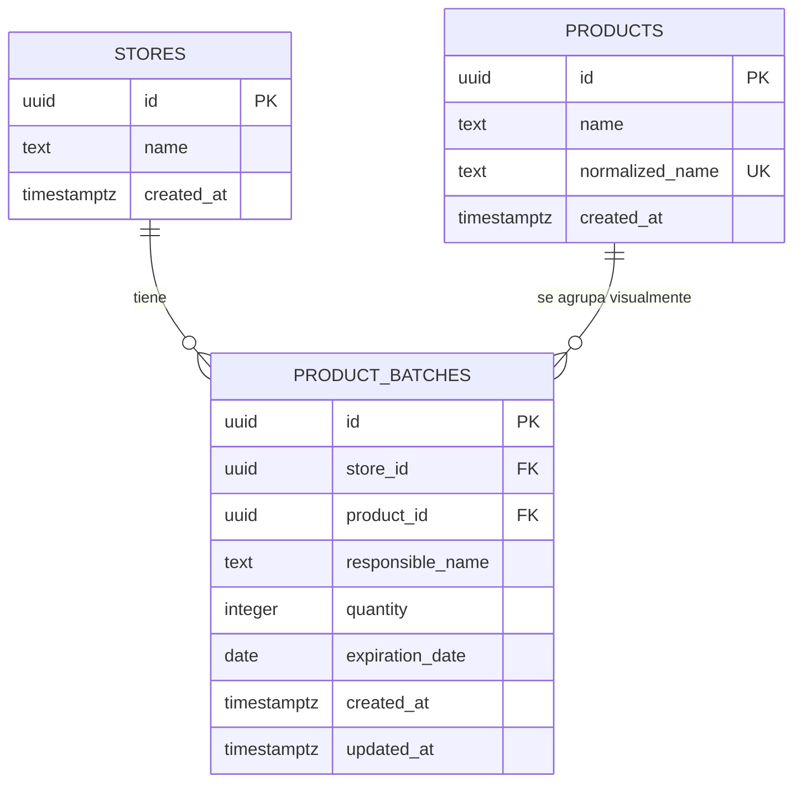

# TRD — Control de Vencimientos

> Documento técnico: modelo de datos, seguridad, contrato de la RPC, migraciones y operación. Complementa a [PRD.md](PRD.md) y [CONTEXT.md](../CONTEXT.md).

## 1. Arquitectura de datos



- **`stores`**: una fila sembrada (`Tienda principal`). El frontend no la consulta ni envía `store_id`; `product_batches.store_id` se resuelve con `default public.current_store_id()`. Preparado para multi-tienda sin UI ni cambios de contrato.
- **`products`**: catálogo compartido. `normalized_name` lo calcula un trigger; `name` conserva el rótulo original y nunca se reescribe por normalización.
- **`product_batches`**: unidad de negocio. Cada fila es un registro independiente; **no** hay restricción de unicidad por producto o fecha.

## 2. Integridad declarada en la base

| Tabla | Restricción | Motivo |
|---|---|---|
| `stores` | `name` 1–80 caracteres | Evitar tiendas sin nombre |
| `products` | `normalized_name` UNIQUE | Un solo registro de catálogo por producto |
| `products` | `name` 1–120 | Coincide con la validación del cliente |
| `product_batches` | `quantity > 0` (integer) | No hay cantidades nulas, cero ni negativas |
| `product_batches` | `responsible_name` 1–80 | Coincide con el formulario |
| `product_batches` | `expiration_date date` NOT NULL | Fecha de calendario, sin zona horaria |
| `product_batches` | FK `store_id`, `product_id` `on delete restrict` | No se borran productos con registros |

Índices: `(store_id, expiration_date)` para el listado principal, `(product_id)` para la relación y `(store_id, responsible_name)` para el filtro por encargado.

`updated_at` se mantiene con el trigger `product_batches_set_updated_at`. Nunca se guarda `days_remaining`: se calcula en el cliente (`src/lib/expiry.ts`).

## 3. Normalización de productos

`public.normalize_product_name(text)`:

1. `lower()`.
2. `translate()` de vocales acentuadas, `ñ` y `ç` (cubre español y latin-1).
3. `regexp_replace` de espacios múltiples y `btrim`.

Es `IMMUTABLE` y no usa la extensión `unaccent`, así que funciona en restricciones e índices sin depender de `search_path`. En el cliente, `src/lib/text.ts` replica la misma regla para búsqueda y sugerencias.

Consecuencia: «Leche Gloria», «leche gloria» y « LECHE GLORIA » son el mismo producto del catálogo. El primer nombre registrado es el que se muestra.

## 4. Seguridad: RLS y acceso

- RLS activada en `stores`, `products` y `product_batches`.
- Políticas **solo** para `authenticated`. `anon` no tiene políticas: no puede leer ni escribir, aunque la anon key sea pública.
- Sin política de `DELETE` sobre `products` (el catálogo no se borra desde la app).
- **Registro público desactivado** en Supabase Auth; el administrador se crea a mano en el dashboard.
- `register_batches` es `security invoker`: respeta RLS y no escala privilegios.
- `execute` revocado a `public` y `anon`; concedido a `authenticated`.
- La `service_role` key no aparece en el cliente, en `.env.example` ni en la documentación. `src/lib/env.ts` aborta si detecta una clave con forma de `service_role`.

Limitación conocida: cualquier usuario autenticado es tratado como personal de la tienda. Cuando existan roles, las políticas `using (true)` se sustituirán por pertenencia a una tabla de miembros (previsto, fuera de alcance v1).

## 5. RPC `register_batches`

```sql
public.register_batches(p_responsible text, p_rows jsonb) returns integer
```

`p_rows` es un arreglo JSON con `product_name`, `quantity` y `expiration_date`. El cliente envía **todas** las filas del alta grupal en una sola llamada; la función:

1. Valida encargado y arreglo no vacío.
2. Recorre las filas en orden; valida producto, cantidad y fecha.
3. Inserta el producto si no existe (`on conflict (normalized_name) do nothing`) y recupera su id.
4. Inserta el registro de vencimiento.
5. Devuelve cuántas filas insertó.

Todo ocurre en la transacción de la llamada: **si una fila falla, no se guarda ninguna**. El alta individual usa la misma función con una sola fila, de modo que hay un único camino de escritura.

| Código | Cuándo | Mensaje en la UI |
|---|---|---|
| `RESPONSIBLE_REQUIRED` | Encargado vacío | Ingresa el nombre del encargado. |
| `RESPONSIBLE_TOO_LONG` | > 80 caracteres | El nombre del encargado no puede superar 80 caracteres. |
| `ROWS_REQUIRED` | Sin filas | Agrega al menos un producto antes de guardar. |
| `PRODUCT_REQUIRED` | Producto vacío | Ingresa el nombre del producto. |
| `PRODUCT_TOO_LONG` | > 120 caracteres | El nombre del producto no puede superar 120 caracteres. |
| `INVALID_QUANTITY` | Cantidad ≤ 0 o nula | La cantidad debe ser mayor que cero. |
| `INVALID_DATE` | Fecha nula o inválida | Selecciona una fecha de vencimiento válida. |

El mapeo vive en `src/lib/errors.ts`.

## 6. Migraciones

Archivos en `supabase/migrations/`, en orden:

| Archivo | Contenido |
|---|---|
| `0001_core.sql` | Tablas, tienda sembrada, normalización, triggers e índices |
| `0002_rls.sql` | RLS y políticas |
| `0003_rpc.sql` | `register_batches` y permisos |

Procedimiento (SQL Editor de Supabase, uno por uno):

1. Pegar y ejecutar `0001_core.sql` → «Success».
2. Ejecutar `0002_rls.sql`.
3. Ejecutar `0003_rpc.sql`.

Son idempotentes (`if not exists`, `create or replace`, `drop policy if exists`). No hay migraciones destructivas. Para revertir: `drop table public.product_batches, public.products, public.stores cascade;` (solo en un proyecto de prueba y con backup).

## 7. Variables de entorno y despliegue

| Variable | Dónde | Notas |
|---|---|---|
| `VITE_SUPABASE_URL` | `.env.local` y Vercel | Pública |
| `VITE_SUPABASE_ANON_KEY` | `.env.local` y Vercel | Pública; RLS es la protección |

`.env.local` está ignorado por Git. En Vercel se definen para Production, Preview y Development. Sin variables, el build de producción muestra la pantalla de configuración (no arranca con datos de ejemplo).

## 8. Verificación

Comprobación automatizada (sin credenciales privilegiadas):

```bash
pnpm run check:supabase
```

Lee `.env.local` o `.env` y verifica: Auth accesible, registro público desactivado, las tres tablas accesibles con la clave pública, `register_batches` presente y no ejecutable por `anon`, y escritura anónima rechazada. Devuelve código 1 si algo falla.

Comprobaciones manuales en el SQL Editor:

```sql
-- RLS activa en las tres tablas
select tablename, rowsecurity from pg_tables where schemaname = 'public';

-- La RPC no es security definer
select proname, prosecdef from pg_proc where proname = 'register_batches';

-- Normalización
select public.normalize_product_name('  LECHE   Gloria ') as normalizado;
-- esperado: 'leche gloria'
```

Con la `anon key` (sin sesión), desde una terminal:

```bash
curl -s "$VITE_SUPABASE_URL/rest/v1/product_batches?select=id" \
  -H "apikey: $VITE_SUPABASE_ANON_KEY" \
  -H "Authorization: Bearer $VITE_SUPABASE_ANON_KEY"
# esperado: [] (ninguna fila visible)
```

En la aplicación:

1. Iniciar sesión con el usuario administrador.
2. Registrar un producto y recargar: debe seguir ahí.
3. Registrar un alta grupal de 3 filas y comprobar que aparecen 3 registros.
4. Abrir en otro dispositivo con la misma cuenta: mismos datos.
5. Cerrar sesión: no se ve ningún dato.

Estado (2026-11-13): proyecto `hctnhfazszxkxcimadrm` accesible; **faltan las migraciones** (tablas no creadas) y el **registro público está abierto**. `check:supabase` devuelve 1/7 hasta completar los pasos. La Fase 4 no se considera cerrada.

## 9. Operación

- **Backups:** Supabase los gestiona según plan; antes de cualquier cambio de esquema se exporta el proyecto de prueba.
- **Logs:** Supabase (API/Auth/Postgres) y Vercel (build/runtime). La app traduce errores y no muestra detalles internos.
- **Límites:** una sola consulta de registros con orden por fecha; sin paginación en v1 (se asume una tienda; revisar si supera ~5 000 filas).
- **Rendimiento del bundle:** `@supabase/supabase-js` añade ~140 kB gzip al bundle inicial; aceptable para una app interna. Si crece, se puede cargar el cliente de forma diferida.

## 10. Deuda técnica declarada

- Sin roles ni multi-tienda operativa (solo preparado en el esquema).
- Sin recuperación de contraseña en la UI (se hace desde el dashboard de Supabase).
- Sin Realtime: la sincronización entre dispositivos es por recarga.
- Tipos de base de datos escritos a mano; si el esquema crece, conviene generarlos con la CLI.
